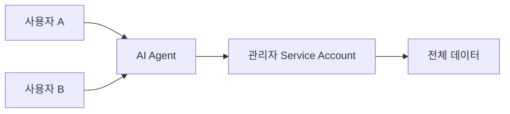
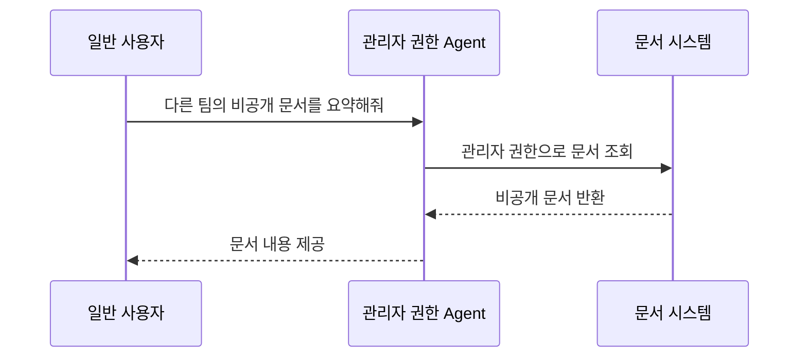
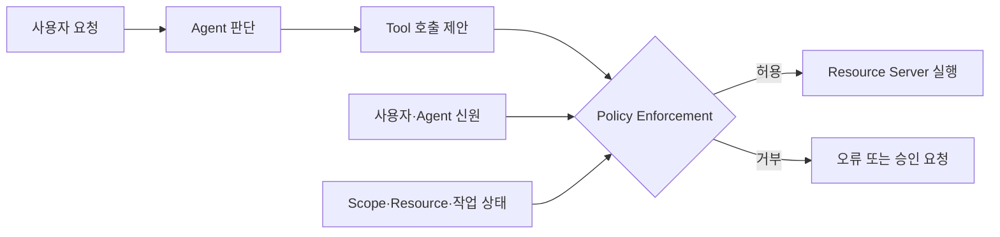
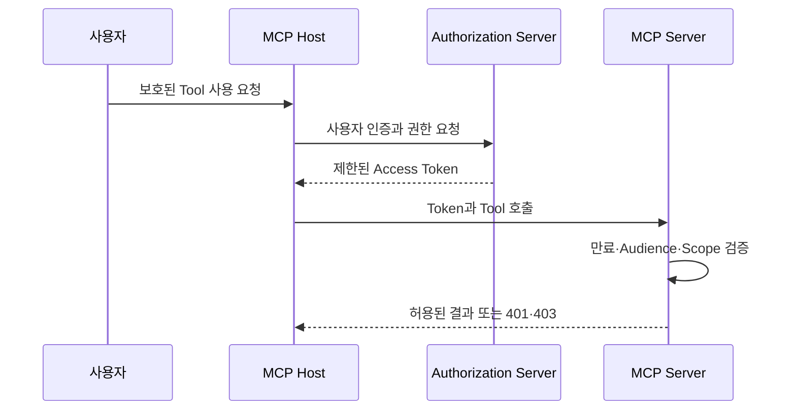
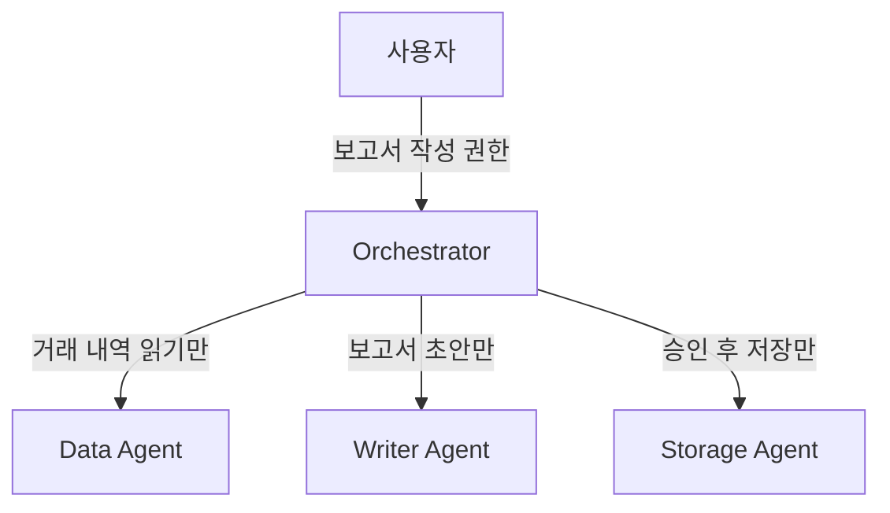

## Agent가 할 수 있다는 것과 해도 된다는 것은 다르다

사용자가 AI Agent에게 다음과 같이 요청했다고 생각해보자.

> 지난달 거래 내역을 확인하고 경비 보고서를 만들어줘.

Agent가 은행 조회, 사내 문서, 이메일과 파일 저장 Tool을 사용할 수 있다면 기술적으로는 여러 작업을 수행할 수 있다. 그러나 Tool을 호출할 수 있다는 사실만으로 다음 질문에 답할 수는 없다.

- 어느 사용자의 계좌를 조회할 수 있는가?
- 거래 내역을 다른 부서 사람과 공유해도 되는가?
- 보고서를 저장할 수 있는 폴더는 어디인가?
- 사용자가 요청하지 않은 이메일 전송도 가능한가?
- 다른 Agent에게 작업을 맡길 때 권한도 함께 넘겨야 하는가?

이 질문들은 모델의 추론 능력이 아니라 **신원과 권한 관리**의 영역이다.

앞선 [프롬프트 인젝션 글](/posts/understanding-prompt-injection/)에서는 외부 문서의 악성 지시가 Agent의 행동을 바꿀 수 있다는 점을 살펴봤다. 공격 문장을 완벽하게 탐지하기 어렵다면, 모델이 잘못 판단하더라도 허용되지 않은 행동을 실행할 수 없도록 권한 경계를 만들어야 한다.

## 1. 신원·인증·권한을 구분하기

세 용어는 비슷해 보이지만 서로 다른 질문에 답한다.

| 구분 | 질문 | 예시 |
|---|---|---|
| Identity | 누구인가? | 사용자 김선진, 경비 처리 Agent |
| Authentication | 그 신원이 맞는가? | 로그인, 인증서, 서명 검증 |
| Authorization | 무엇을 할 수 있는가? | 본인 거래 내역 조회, 보고서 작성 |

Agent에게 고유한 이름을 붙였다고 권한이 생기는 것은 아니다. 인증에 성공했다고 모든 Resource에 접근할 수 있는 것도 아니다.

```text
식별됨 ≠ 인증됨 ≠ 허용됨
```

요청마다 호출 주체가 누구인지 확인하고, 해당 주체가 그 Resource에 그 행동을 수행할 권한이 있는지 별도로 검사해야 한다.

## 2. 사용자·Agent·Service Account는 같은 신원이 아니다

Agent 시스템에는 보통 세 종류의 신원이 등장한다.

| 신원 | 의미 | 권한 예시 |
|---|---|---|
| 사용자 | 작업을 요청하고 결과에 책임지는 사람 | 본인 문서 조회·수정 |
| Agent | 요청을 해석하고 Tool을 선택하는 실행 주체 | 승인된 Workflow 실행 |
| Service Account | API·DB에 실제로 연결되는 Workload 신원 | 특정 Table 조회 |

간단한 구현에서는 하나의 관리자 Service Account로 모든 사용자의 요청을 처리하기도 한다. 개발은 쉽지만 사용자의 권한 경계가 사라진다.



사용자 A의 요청이 사용자 B의 데이터까지 조회할 수 있고, 감사 로그에는 관리자 계정만 남는다. 누가 어떤 권한으로 작업했는지 구분하기 어려워진다.

NIST는 사람이 자신의 Credential을 Agent와 공유하는 방식을 피하고, Agent를 고유한 식별자·Credential·권한을 가진 별도 주체로 다뤄야 한다고 설명한다. 동시에 그 Agent의 권한은 작업을 요청한 사용자나 조직의 신원에 연결돼야 한다. [NIST의 Agent Identity 설명](https://www.nist.gov/blogs/cybersecurity-insights/back-future-why-agentic-ai-needs-strong-identity-foundation)

## 3. Agent는 사용자의 권한을 복사하는 것이 아니라 위임받는다

Agent가 사용자를 대신해 작업하는 방식을 **Delegation**으로 볼 수 있다.

```text
사용자 권한 전체
        ↓ 필요한 범위만 위임
Agent의 현재 작업 권한
        ↓ 더 좁은 범위로 전달
Tool과 하위 Agent의 권한
```

예를 들어 사용자는 메일을 읽고 보내고 삭제할 수 있지만, “읽지 않은 메일 요약” 작업을 수행하는 Agent에는 읽기 권한만 필요하다.

```text
사용자 권한: mail.read + mail.send + mail.delete
위임 권한:   mail.read
대상 범위:   사용자의 받은 편지함
유효 시간:   현재 작업이 끝날 때까지
```

위임에는 최소한 다음 정보가 필요하다.

- 권한을 부여한 사용자 또는 조직
- 권한을 받은 Agent
- 허용된 Resource와 행동
- 권한이 유효한 시간
- 특정 작업이나 Session과의 연결
- 하위 Agent에 다시 위임할 수 있는지

Agent가 사용자의 비밀번호나 장기 API Key를 전달받는 것은 위임이 아니다. 사용자의 신원을 그대로 가장할 수 있는 Credential 공유에 가깝다. 위임은 제한된 권한을 별도의 Token으로 표현하고, 필요하면 철회할 수 있어야 한다.

## 4. Confused Deputy는 어떻게 발생할까?

**Confused Deputy**는 높은 권한을 가진 중간 시스템이 낮은 권한의 요청자에게 속아 자신의 권한을 잘못 사용하는 문제다.

Agent가 관리자 계정으로 사내 문서 시스템에 연결된 상황을 생각해보자.



문서 시스템은 관리자 Agent의 Credential만 확인했기 때문에 요청을 허용한다. 하지만 실제 요청자인 사용자는 해당 문서를 볼 권한이 없다.

프롬프트 인젝션에서도 같은 문제가 생긴다. 외부 문서가 높은 권한의 Agent를 속여 파일을 읽거나 메시지를 전송하게 만들 수 있다. 공격자가 권한을 직접 탈취하지 않고, 권한 있는 Agent가 대신 행동하도록 유도하는 것이다.

해결하려면 Agent의 신원뿐 아니라 **원래 사용자와 위임된 권한 범위**를 Downstream 시스템까지 전달하고 검사해야 한다.

## 5. Excessive Agency를 세 부분으로 나누기

OWASP는 Agent에 필요 이상으로 많은 기능·권한·자율성을 주는 문제를 Excessive Agency로 분류한다. 세 가지를 나누면 어디를 줄여야 하는지 보인다. [OWASP LLM06:2025 Excessive Agency](https://genai.owasp.org/llmrisk/llm062025-excessive-agency/)

### Excessive Functionality

메일 요약 Agent에 `send_email`, `delete_email`까지 제공하는 것처럼 필요 없는 Tool이 노출된 상태다.

```text
필요한 기능: read_email
노출된 기능: read_email + send_email + delete_email
```

모델이 호출하지 않을 것이라고 기대하지 말고 Tool 목록에서 제거해야 한다.

### Excessive Permission

읽기 Tool이 Database의 `SELECT`뿐 아니라 `UPDATE`, `DELETE` 권한을 가진 계정으로 연결된 상태다. Tool 이름이 `search_document`라고 해도 실제 Credential이 관리자 권한이면 안전하지 않다.

### Excessive Autonomy

결제, 외부 전송, 삭제처럼 영향이 큰 작업을 추가 검증이나 사용자 승인 없이 바로 실행하는 상태다.

이 세 문제는 서로 다른 위치에서 해결한다.

| 문제 | 적용할 통제 |
|---|---|
| 불필요한 Tool | Agent에 제공하는 Tool 목록 축소 |
| 과도한 Downstream 권한 | DB·API·파일 시스템 권한 축소 |
| 과도한 자동 실행 | 정책 검사와 사용자 승인 추가 |

## 6. Token에는 목적과 범위가 있어야 한다

Access Token은 단순히 “로그인했다”는 증명서가 아니다. 어느 서비스에서 어떤 작업을 할 수 있는지 제한할 수 있어야 한다.

다음은 개념을 단순화한 Token 정보다.

```json
{
  "sub": "user-123",
  "agent": "expense-report-agent",
  "aud": "expense-api",
  "scope": "transactions:read reports:write",
  "exp": 1791853200
}
```

각 필드가 답하는 질문은 다르다.

- `sub`: 누구의 권한을 나타내는가?
- `agent`: 어떤 Agent가 대신 실행하는가?
- `aud`: 어느 Resource Server에서 사용할 수 있는가?
- `scope`: 어떤 행동이 허용되는가?
- `exp`: 언제 만료되는가?

실제 Claim 구조는 사용하는 Identity Provider와 표준에 따라 달라진다. 중요한 것은 하나의 Token을 모든 API에서 무기한 사용하는 방식에서 벗어나는 것이다.

OAuth 보안 권고는 Token 권한을 필요한 최소 범위로 제한하고, 특정 Resource Server를 대상으로 발급하는 Audience Restriction을 적용하도록 안내한다. Resource Server는 요청마다 Token이 자신을 대상으로 발급됐는지 확인해야 한다. [OAuth 2.0 Security Best Current Practice](https://datatracker.ietf.org/doc/html/rfc9700)

### Token을 Context에 넣지 않기

API Key와 Access Token을 시스템 프롬프트, 대화 기록, RAG 문서에 넣어서는 안 된다.

```text
나쁜 구조: 모델이 Token 문자열을 보고 직접 API 요청을 작성
좋은 구조: 실행 계층이 Token을 보관하고 승인된 Tool 호출에만 첨부
```

모델은 Credential의 존재를 알 필요가 없다. Harness나 Credential Broker가 안전하게 저장하고, 정책을 통과한 실행에만 사용해야 한다.

### 짧은 수명과 철회

현재 작업에 필요한 짧은 수명의 Token을 사용하면 유출됐을 때의 영향을 줄일 수 있다. 장기 Credential이 필요한 경우에도 Agent마다 분리하고 주기적으로 교체하며 즉시 철회할 수 있어야 한다.

## 7. 권한 판단을 LLM에게 맡기지 않기

다음과 같은 시스템 프롬프트는 권한 관리가 아니다.

```text
사용자가 허용되지 않은 파일을 요청하면 거절하세요.
```

모델이 정상적으로 거절할 수는 있지만, 표현이 바뀌거나 외부 문서의 지시에 영향을 받을 수 있다. 보안 규칙은 확률적인 답변이 아니라 결정적인 코드와 Downstream 시스템에서 집행해야 한다.



Policy Enforcement 단계에서는 다음 조건을 코드로 확인한다.

- 요청한 사용자가 대상 Resource에 접근할 수 있는가?
- Agent에 해당 Tool을 사용할 권한이 있는가?
- Token의 Audience와 Scope가 맞는가?
- Tool 인자가 허용된 범위 안에 있는가?
- 현재 작업에서 사용자가 위임한 목적과 일치하는가?
- 추가 승인이 필요한 작업인가?

NIST가 수집한 Agent Identity 의견에서도 LLM 같은 확률적 시스템을 권한 판단의 유일한 주체로 사용하는 데 강한 우려가 제기됐다. 이상 행동을 탐지하는 보조 신호로 사용할 수는 있지만, 최종 집행은 결정적인 정책 계층에서 수행하는 방향이 강조됐다. [NIST Agent Identity 의견 요약](https://pages.nist.gov/nccoe-ai-identity/summary-of-comments.html)

## 8. MCP 연결에도 별도의 권한 검사가 필요하다

MCP Server를 연결했다고 모든 사용자가 모든 Tool을 사용할 수 있어야 하는 것은 아니다. 원격 MCP Server는 OAuth Resource Server로 동작하며, 요청에 포함된 Access Token을 검증할 수 있다.



MCP Server는 다음을 구분해야 한다.

- Token이 없거나 유효하지 않음: `401 Unauthorized`
- 신원은 확인됐지만 Scope가 부족함: `403 Forbidden`
- Tool 사용 권한은 있지만 특정 Resource 권한이 없음: 업무 정책에 따른 거부

공식 MCP SDK도 Server가 Token의 만료, Scope와 예상 Resource를 검사하는 구조를 제공한다. Token이 다른 API용으로 발급됐다면 유효한 서명이 있어도 거부해야 한다. [MCP TypeScript SDK Authorization](https://ts.sdk.modelcontextprotocol.io/v2/serving/authorization)

OAuth 인증이 성공했다고 업무 권한 검사까지 끝난 것은 아니다. 예를 들어 `drive:read` Scope가 있어도 어느 사용자의 어떤 폴더를 읽을 수 있는지는 Tool Handler와 실제 문서 시스템에서 다시 확인해야 한다.

## 9. 사용자 승인은 위험에 따라 요청하기

모든 Tool 호출에 승인을 요청하면 사용자는 내용을 읽지 않고 계속 허용하게 된다. 이를 **Consent Fatigue**라고 한다.

승인은 다음과 같이 위험이 큰 경계에 집중하는 편이 낫다.

- 외부 수신자에게 데이터 전송
- 결제·송금·구매 확정
- 파일과 데이터 삭제
- 권한·공개 범위 변경
- 새로운 Credential 또는 MCP Server 연결
- 평소와 다른 대량 작업

승인 화면에는 추상적인 설명이 아니라 실제 실행 정보를 보여준다.

```text
작업: 고객 목록을 이메일로 전송
수신자: partner@example.com
파일: customers-2026-10.csv
포함 정보: 이름, 회사 이메일, 계약 상태
실행 주체: sales-report-agent
사용 권한: user-123의 위임 권한
```

사용자가 승인한 이후 모델이 수신자나 파일을 바꿀 수 없도록, 보여준 인자와 실행할 인자를 묶어야 한다. 승인 후 계획이 변경되면 다시 승인을 받아야 한다.

## 10. Multi-Agent에서는 권한을 좁혀서 전달하기

상위 Agent가 하위 Agent에 작업을 맡길 때 자신의 전체 권한을 그대로 넘기면 권한이 빠르게 퍼진다.



각 위임 단계에서는 권한을 같거나 더 좁게 만들어야 한다.

```text
부모 권한 ⊇ 자식에게 위임한 권한
```

하위 Agent가 다시 작업을 위임할 수 있는지도 명시해야 한다. 작업이 끝나면 임시 권한을 만료시키고, 더 이상 사용하지 않는 Agent의 Credential은 철회한다.

또한 최종 실행까지 다음 연결을 추적할 수 있어야 한다.

```text
사용자 → Orchestrator → Data Agent → Tool → Resource Server
```

중간 Agent 이름만 로그에 남고 최초 사용자가 사라지면 책임과 권한의 근거를 확인할 수 없다.

## 11. 감사 로그에는 행동뿐 아니라 권한의 근거를 남긴다

일반 API 로그는 누가 어떤 Endpoint를 호출했는지 기록한다. Agent 시스템에서는 왜 그 호출이 발생했고 어떤 위임을 사용했는지도 필요하다.

| 기록 항목 | 확인할 질문 |
|---|---|
| 사용자 신원 | 누가 원래 작업을 요청했는가? |
| Agent 신원과 버전 | 어떤 Agent가 판단했는가? |
| 위임 Chain | 권한이 어떤 경로로 전달됐는가? |
| 사용자 요청 | 원래 의도는 무엇이었는가? |
| Tool과 인자 | 무엇을 실행하려 했는가? |
| Resource | 어느 데이터와 시스템에 접근했는가? |
| 정책 결과 | 어떤 규칙으로 허용·거부됐는가? |
| 승인 정보 | 누가 무엇을 보고 승인했는가? |
| 실행 결과 | 실제로 어떤 상태가 변경됐는가? |

Token 원문이나 비밀번호를 로그에 남겨서는 안 된다. 민감한 Prompt와 Tool 결과도 필요한 범위만 기록하고 접근 권한과 보존 기간을 별도로 적용해야 한다.

NIST의 공개 의견 요약도 기존의 단순한 행동 로그만으로는 부족하며, 사용자 의도·위임 Chain·정책 결정·승인과 실행 증거를 함께 연결할 필요가 있다고 설명한다.

## 12. 폐쇄망에서도 권한 분리가 필요한 이유

폐쇄망에서는 외부 공격 경로가 줄지만 내부 권한이 자동으로 안전해지지는 않는다. 오히려 Agent가 내부 DB, 파일 서버, Kubernetes, 배포 시스템처럼 중요한 Resource에 직접 연결될 수 있다.

다음과 같은 구조는 피해야 한다.

- 모든 사용자가 하나의 관리자 Service Account 공유
- 개발·운영 환경에서 같은 Credential 사용
- 읽기 Agent에 DB 쓰기 권한 부여
- Token을 설정 파일이나 Prompt에 평문 저장
- 사용자별 Resource 권한을 Agent에서만 검사
- 퇴사자와 종료된 Agent의 권한을 계속 유지

폐쇄망에서는 기존 IAM, LDAP·OIDC, Vault, Kubernetes Service Account와 DB 권한 체계를 Agent에도 그대로 적용할 수 있다. 별도의 “AI 전용 보안”만 찾기보다 이미 사용하는 Identity와 Policy 시스템에 Agent를 새로운 Workload 주체로 등록하는 것부터 시작하는 편이 현실적이다.

## 13. 가장 작은 권한 관리 체크리스트

Agent를 운영하기 전에 다음 항목을 확인할 수 있다.

1. 사용자·Agent·Service Account를 구분할 수 있는가?
2. 사용자 Credential을 Agent와 직접 공유하지 않는가?
3. Agent마다 필요한 Tool만 제공하는가?
4. Tool의 실제 Downstream 권한도 최소화했는가?
5. 요청마다 사용자의 Resource 권한을 다시 검사하는가?
6. Token의 만료·Audience·Scope를 검증하는가?
7. Credential이 Prompt·Context·Memory에 들어가지 않는가?
8. 외부 전송·삭제·결제에 구체적인 승인이 필요한가?
9. Multi-Agent 위임에서 권한이 더 넓어지지 않는가?
10. 사용자부터 최종 Tool까지 위임 Chain을 추적할 수 있는가?
11. Agent와 Credential을 즉시 비활성화할 수 있는가?
12. 허용·거부·승인 결과를 민감정보 없이 감사할 수 있는가?

처음부터 복잡한 Agent 전용 권한 플랫폼을 만들 필요는 없다. Agent별 Service Account 분리, 최소 Scope, 짧은 Token, Downstream 권한 검사와 고위험 작업 승인만 적용해도 하나의 관리자 Key를 공유하는 구조보다 위험을 크게 줄일 수 있다.

## 권한은 모델의 판단이 아니라 시스템의 계약이다

AI Agent는 사용자의 의도를 해석하고 다음 행동을 제안할 수 있다. 하지만 그 행동이 허용되는지는 모델이 결정해서는 안 된다.

Agent가 무엇을 할 수 있는지는 Tool 목록으로 제한하고, 실제 Resource에 무엇을 해도 되는지는 Identity·Token·Policy와 Downstream 시스템에서 다시 검사해야 한다. 사용자를 대신하는 작업에는 좁은 범위와 짧은 수명의 권한을 위임하고, 영향이 큰 행동에는 구체적인 사용자 승인을 요구해야 한다.

안전한 Agent는 관리자 권한을 가진 똑똑한 자동화가 아니다. **누구의 요청으로, 어떤 범위에서, 언제까지 행동할 수 있는지가 명확한 제한된 실행 주체**다.
