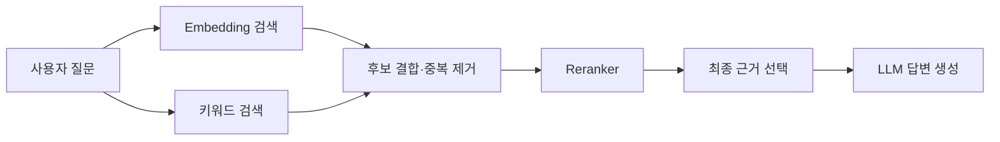

## 출장 문서는 찾았는데 지급 기준은 보이지 않는다

사내 문서를 검색하는 RAG 서비스에 다음과 같이 질문했다고 생각해보자.

> 2026년 국내 출장에서 서울 지역 숙박비는 1박에 얼마까지 지급되나요?

검색 결과에는 출장 신청 안내, 출장 결과 보고서, 출장비 규정이 나온다. 모두 출장과 관련된 문서지만, 실제 지급 한도가 적힌 별표는 아래쪽에 묻혀 있다.

이때 Embedding 모델을 바꾸면 될까? 검색 결과를 더 많이 가져와야 할까? 아니면 Reranker를 추가해야 할까?

앞선 [RAG 실패 진단 글](/posts/rag-failure-diagnosis/)에서는 문서 전처리부터 답변 생성까지 실패 지점을 나눠봤다. 이번 글에서는 그중 **질문에 필요한 후보를 찾는 과정과 후보의 순서를 다시 정하는 과정**에 집중한다.

> 아래 규정·금액·문서 ID와 순위는 설명을 위한 가상 예시다. 특정 기관의 실제 규정이나 모델 실행 결과가 아니다. Embedding도 정답 근거를 상위에 올릴 수 있고 Reranker도 틀릴 수 있다. 두 모델을 각각 “주제 검색기”와 “정답 판별기”로 고정해서 이해하지 않는다.
{: .prompt-info }

## 1. 먼저 답을 담은 문서 조각을 정하기

검색 대상을 다음과 같이 준비했다고 하자. 여기서는 문서 전체보다 작은 검색 단위를 **Chunk**라고 부른다.

| Chunk ID | 제목 | 본문 요약 |
|---|---|---|
| A | 국내 출장 신청 안내 | 출장 신청서 작성과 결재 절차를 설명한다. |
| B | 2026년 여비 규정 별표 2 | 국내 출장 숙박비 상한: 서울 1박 100,000원, 그 외 지역 80,000원. |
| C | 2024년 여비 규정 별표 2 | 국내 출장 숙박비 상한: 서울 1박 90,000원. 현재는 폐기된 규정이다. |
| D | 국외 출장 숙박비 기준 | 해외 지역별 숙박비 지급 기준을 설명한다. |
| E | 출장 결과 보고서 작성법 | 출장 종료 후 보고서 작성과 제출 방법을 설명한다. |

질문에 직접 답하는 근거는 B다. A와 E는 같은 주제이지만 금액을 담고 있지 않다. C는 금액이 있어도 적용 연도가 다르고, D는 국내 출장이 아닌 국외 출장에 관한 문서다.

따라서 이 검색의 목표는 “출장 문서가 나오는가?”보다 구체적이어야 한다.

**질문의 지역·연도·지급 항목에 맞는 근거가 최종 입력에 포함되는가?**

실제 규정에는 직급, 실비 정산, 예외 승인 같은 조건도 있을 수 있다. 금액만 떼어내지 않고 적용 범위와 예외를 함께 보존해야 한다. 원문에서 이 정보가 사라졌다면 검색 모델을 바꾸기 전에 전처리와 Chunk 구성을 확인한다.

## 2. Embedding은 질문과 문서를 비교할 수 있는 벡터로 바꾼다

Embedding 모델은 텍스트를 숫자로 이루어진 벡터로 표현한다. 검색에서는 질문과 문서를 각각 벡터로 만든 뒤, 코사인 유사도나 내적 등 모델에 맞는 방식으로 비교한다.

```text
색인 시점
문서 Chunk → 문서 인코더 → 문서 벡터 저장

검색 시점
사용자 질문 → 질문 인코더 → 질문 벡터
                              ↓
                    문서 벡터와 비교해 후보 검색
```

질문과 문서를 독립적으로 인코딩하는 구조를 흔히 **Bi-Encoder**라고 부른다. 모델에 따라 같은 인코더를 사용하거나 질문·문서용 인코더를 구분할 수 있다.

문서 벡터는 미리 계산해 둘 수 있으므로, 검색할 때마다 모든 문서 본문을 모델로 다시 읽지 않아도 된다. 문서가 많아지면 벡터 인덱스의 근사 최근접 이웃 검색 등을 사용해 후보를 찾을 수 있다. 후보 생성 뒤 다른 모델로 재정렬하는 흐름은 [Sentence Transformers의 Retrieve & Re-Rank 문서](https://www.sbert.net/examples/sentence_transformer/applications/retrieve_rerank/README.html)에서도 설명한다.

### 표현이 달라도 검색할 수 있다는 장점

질문에 “호텔비”라고 적혀 있고 문서에 “숙박비”라고 적혀 있어도, 해당 표현을 잘 학습한 모델은 관련성을 반영할 수 있다. 사용자의 자연스러운 질문과 규정 문체 사이를 연결하는 데 유용하다.

다만 업무 용어, 약어, 숫자 조건을 항상 정확하게 이해하는 것은 아니다. “국내”와 “국외”, “지급”과 “지급 제외”처럼 작은 차이가 중요한 질문도 실제 데이터로 확인해야 한다.

### 같은 모델이어도 입력 방법을 맞춰야 한다

모델마다 권장 입력 형식이 다르다. 예를 들어 `multilingual-e5-base` 모델 카드는 비영어 텍스트의 검색에서도 질문에 `query: `, 문서에 `passage: ` 접두사를 사용하도록 안내한다. 정규화와 유사도 계산 방식도 모델의 사용법에 맞춘다. [Multilingual E5 모델 카드](https://huggingface.co/intfloat/multilingual-e5-base)

```text
질문 입력: query: 서울 출장 호텔비는 얼마까지 나오나요?
문서 입력: passage: 2026년 여비 규정 별표 2. 서울 숙박비 상한은 ...
```

이 접두사를 모든 Embedding 모델에 공통으로 붙인다는 뜻은 아니다. 질문용 지시문을 요구하는 모델도 있고 별도 접두사가 필요 없는 모델도 있다.

또한 벡터 차원이 같다는 이유만으로 서로 다른 모델의 질문·문서 벡터를 섞지 않는다. 모델을 교체하면 기존 문서 재임베딩과 인덱스 전환이 필요한지 검토한다.

## 3. 키워드 검색은 정확한 표기를 찾는 데 도움이 된다

모든 질문이 의미 유사도만으로 해결되지는 않는다.

> 여비규정 제12조의 숙박비 기준을 찾아줘.
>
> 오류 코드 ERR-1042의 조치 방법은?

규정 번호, 오류 코드, 제품명처럼 특정 표기가 중요한 질문에는 키워드 검색이 도움이 된다. 대표적인 BM25는 검색어의 출현 빈도, 문서 집합에서의 희소성, 문서 길이 등을 반영해 순위를 계산한다. [Elasticsearch의 BM25 설명](https://www.elastic.co/docs/reference/elasticsearch/index-settings/similarity#bm25-similarity-default)

하지만 키워드 검색도 단순한 문자열 포함 검사와 같지는 않다. 실제 검색 결과는 형태소 분석, 토큰화, 동의어와 필드 설정 등에 영향을 받는다.

예를 들어 `ERR-1042`를 분석 과정에서 잘라버리면 원하는 코드와 다른 결과가 섞일 수 있다. 코드나 문서 ID가 정확히 일치해야 한다면 분석하지 않는 식별자 필드와 정확 일치 질의를 별도로 설계한다.

| 질문 유형 | 우선 확인할 검색 방식 |
|---|---|
| “서울 출장 호텔비는?”처럼 표현이 다양한 질문 | 의미 검색이 업무 표현을 잘 연결하는지 확인 |
| 규정 번호·오류 코드·식별자가 있는 질문 | 키워드 검색과 정확 일치 필드 확인 |
| 자연어 설명과 식별자가 섞인 질문 | 두 방식의 후보를 결합하는 구성 검토 |

어느 방식이 항상 우월한지보다, 실제 질문에서 어떤 근거를 놓치는지 확인하는 것이 먼저다.

## 4. Hybrid Search는 서로 다른 검색 후보를 합친다

Hybrid Search는 의미 검색과 키워드 검색 등을 함께 사용해 후보를 만드는 방식이다.



두 검색 결과를 단순히 이어 붙이면 같은 Chunk가 중복되고 어느 결과를 앞에 둘지 불명확해진다. 점수를 더하는 방식도 사용할 수 있지만, BM25 점수와 벡터 유사도는 척도가 다르므로 그대로 합산하는 데 주의해야 한다.

한 가지 방법은 **RRF(Reciprocal Rank Fusion)**처럼 원래 점수 대신 각 검색 결과에서의 순위를 사용하는 것이다.

```text
RRF 점수(d) = 각 검색 목록에 대해 1 / (c + 해당 목록에서 d의 순위)를 합산
```

순위는 1부터 시작하고, 해당 목록에 없는 문서는 그 목록에서 기여도가 0이다. `c`는 순위 차이의 영향을 조절하는 상수다. 예를 들어 `c=60`일 때 다음과 같이 계산할 수 있다.

| Chunk | 의미 검색 순위 | 키워드 검색 순위 | RRF 점수 |
|---|---:|---:|---:|
| A | 1 | 3 | 약 0.03227 |
| B | 3 | 1 | 약 0.03227 |
| E | 2 | 목록에 없음 | 약 0.01613 |

이 예시에서는 A와 B의 점수가 같다. RRF는 여러 검색 결과를 결합할 뿐, 어떤 문서가 실제 답을 담았는지 새로 읽고 판단하는 모델은 아니다. 동점 처리 규칙도 별도로 정할 수 있다. [Elasticsearch RRF 문서](https://www.elastic.co/docs/reference/elasticsearch/rest-apis/reciprocal-rank-fusion)

권한과 적용 시점처럼 반드시 지켜야 할 조건은 검색·후보 생성 단계에서 적용한다. 사용자에게 허용되지 않은 문서를 Reranker나 외부 API에 전달한 뒤 최종 화면에서만 숨기는 방식으로 처리하지 않는다.

## 5. Reranker는 질문과 후보 문서를 함께 보고 순위를 매긴다

Reranker는 이미 찾은 후보를 대상으로 관련성을 다시 평가한다. 대표적인 구조인 **Cross-Encoder**는 질문과 문서를 하나의 입력 쌍으로 처리한다.

```text
Bi-Encoder
질문 → 질문 벡터 ─┐
                  ├→ 벡터 비교
문서 → 문서 벡터 ─┘

Cross-Encoder
[질문, 후보 문서] → 함께 인코딩 → 관련성 점수
```

질문과 문서 사이의 토큰 관계를 함께 계산할 수 있지만, 질문이 바뀌면 각 후보와의 쌍을 다시 처리해야 한다. 문서 벡터를 미리 계산하는 것처럼 질문과 무관한 최종 점수를 저장해 둘 수는 없다. 그래서 대규모 전체 문서보다 검색으로 좁힌 후보에 적용하는 경우가 많다. [Sentence Transformers CrossEncoder 문서](https://www.sbert.net/docs/package_reference/cross_encoder/model.html)

Reranker가 모두 같은 구조인 것은 아니다. 생성형 LLM이 문서를 비교하거나 목록 전체의 순서를 정하는 방식도 있다. 여기서는 질문·문서 쌍을 점수화하는 Cross-Encoder를 중심으로 생각한다.

앞선 출장비 예시에서 다음과 같은 변화가 생길 수 있다.

| Chunk | 1차 검색 순위 | 재정렬 후 순위 | 구분할 내용 |
|---|---:|---:|---|
| A | 1 | 2 | 출장 신청 절차이며 지급 한도는 없음 |
| E | 2 | 3 | 결과 보고서 작성법이며 지급 한도는 없음 |
| B | 3 | 1 | 질문의 연도·지역·항목에 해당하는 금액이 있음 |

이는 Reranker가 잘 동작했을 때의 가상 예시다. 실제 모델이 이 순서를 반환한다는 보장은 없다. 업무 용어를 이해하지 못하거나 중요한 문장이 입력 길이 제한으로 잘리면 오히려 잘못된 후보를 위로 올릴 수 있다.

### 관련성 점수는 정답 확률이 아니다

Cross-Encoder의 출력은 모델에 따라 Logit일 수도 있고, 변환된 점수일 수도 있다. Sentence Transformers 문서도 일부 MS MARCO 모델이 0~1 점수 대신 Logit을 반환한다고 설명한다. [Cross-Encoder 사용 문서](https://www.sbert.net/docs/cross_encoder/usage/usage.html)

점수가 0.9라고 해서 “이 문서에 정답이 있을 확률이 90%”라고 해석하지 않는다. 모델과 입력이 달라지면 점수 분포도 달라질 수 있다. 후보를 걸러낼 임계값은 실제 관련·비관련 사례와 답변 불가 사례를 사용해 정한다.

## 6. Reranker가 해결하지 못하는 문제

### 후보에 없는 근거는 다시 올릴 수 없다

전체 색인에 B가 있어도 1차 검색 결과가 A·D·E뿐이라면, Reranker는 그 세 후보 안에서만 순위를 바꾼다. 이 경우에는 검색 후보 수, 검색 방식, 질문 표현과 인덱스를 먼저 확인한다.

```text
1차 검색 상위 K개에 B가 없음
  → Reranker만 바꿔서는 B를 복구할 수 없음

1차 검색 상위 K개에 B가 있음
  → 최종 상위 N개에 B가 남는지 확인
```

검색 후보 수 `K`와 최종 문맥 수 `N`을 구분한다. “Top 5를 쓴다”는 설명만으로는 5개만 검색했는지, 50개를 재정렬해 5개를 선택했는지 알 수 없다.

### 잘못된 원문과 빠진 조건을 고쳐주지는 않는다

OCR이 금액을 잘못 읽었거나, 표에서 서울과 다른 지역의 값이 섞였다면 순위가 높아져도 잘못된 근거가 전달된다. 제목과 시행일, 표 설명을 함께 보존하고 모델 입력의 잘림 여부도 확인한다.

또한 질문과 관련성이 높다는 것과 사용 가능한 근거라는 것은 다르다. 폐기된 규정은 질문과 매우 비슷할 수 있다. 현재 규정만 필요한 서비스라면 시행일·폐기 여부를 신뢰할 수 있는 메타데이터로 관리하고 필터링한다.

### 지연이 추가되고 순위도 나빠질 수 있다

후보를 많이 읽거나 문서가 길어지면 재정렬 비용이 늘어난다. 소요 시간은 모델 크기, 입력 길이, 후보 수, 배치와 하드웨어에 따라 달라진다. Reranker를 도입했다는 사실만으로 개선을 선언하지 않고, 순위 변화와 추가 지연을 함께 측정한다.

## 7. 후보 포함률과 순위, 최종 답변을 나눠 평가하기

먼저 평가 질문마다 관련 Chunk를 표시한다. 이 예시에서는 질문의 정답 근거가 B 하나지만, 실제로는 본문과 별표·예외 조항 등 여러 Chunk가 필요할 수 있다.

| 지표 | 확인하는 내용 |
|---|---|
| Hit@K | 상위 K개 안에 관련 Chunk가 하나 이상 있는 질문의 비율 |
| Recall@K | 질문별 전체 관련 Chunk 중 상위 K개가 회수한 비율을 구한 뒤 평균 |
| MRR@K | 상위 K개에서 첫 관련 Chunk의 순위 역수를 질문별로 평균. 없으면 0 |
| nDCG@K | 관련성 등급이 높은 Chunk를 상위에 배치했는지 평가 |
| 지연·실패율 | 검색·재정렬·전체 응답 시간과 요청 실패 비율 |

이 지표들은 [Sentence Transformers의 검색 평가 도구](https://www.sbert.net/docs/package_reference/sentence_transformer/evaluation.html#informationretrievalevaluator)에서도 제공한다. 실제 비교에서는 정답 표시 기준과 평가 단위, K 값을 고정한다.

앞선 실패 진단 글에서는 정답 근거 하나의 포함 여부를 중심으로 Recall@K를 설명했다. **관련 Chunk가 하나인 질문에서는 Hit@K와 Recall@K가 같지만, 여러 개인 경우에는 구분해야 한다.**

예를 들어 관련 Chunk가 본문·별표·예외 조항 세 개이고 검색 결과에 별표만 있다면, 그 질문의 Hit@K는 1이지만 Recall@K는 1/3이다. 여러 근거를 모두 결합해야 하는 업무라면 필요한 근거 전체를 회수했는지도 별도로 확인한다.

### 같은 K개를 재정렬하면 포함된 문서는 바뀌지 않는다

상위 30개 후보의 순서만 바꾸고 30개를 모두 유지했다면 Hit@30과 Recall@30은 바뀌지 않는다. Reranker가 바꾼 것은 순위다.

따라서 다음처럼 비교한다.

- 후보 생성 성능: 1차 검색 결과의 Hit@30·Recall@30
- 순위 개선: 재정렬 전 상위 5개와 재정렬 후 상위 5개의 지표
- 최종 문맥 품질: 근거 누락·중복·잘림 여부
- 답변 품질: 금액·조건·출처의 정확성, 근거가 없을 때의 미답변 판단

30개와 5개는 설명을 위한 값이며 권장 기본값은 아니다. 후보에 있는 근거를 최종 몇 개 안으로 올릴 수 있는지와 시간 예산을 함께 보고 결정한다.

## 8. 처음 비교한다면 네 가지 구성으로 시작하기

처음부터 모든 모델과 설정을 바꾸기보다, 같은 문서·질문·권한 조건에서 구성을 나눠 비교한다.

| 구성 | 비교 목적 |
|---|---|
| A. 키워드 검색 | 정확한 표기와 식별자 검색의 기준값 확인 |
| B. Embedding 검색 | 표현이 다른 질문을 얼마나 잘 연결하는지 확인 |
| C. Hybrid Search | 두 후보를 결합했을 때 누락이 줄어드는지 확인 |
| D. Hybrid Search + Reranker | 같은 후보에서 최종 순위를 개선하는지 확인 |

C와 D를 비교할 때는 1차 후보를 동일하게 유지해야 재정렬의 효과를 보기 쉽다. 최종 문맥 개수와 토큰 예산, 답변 생성 모델도 고정한다.

평가 질문에는 표현을 바꾼 질문, 규정 번호가 포함된 질문, 연도·지역·부정 조건이 중요한 질문, 여러 근거가 필요한 질문, 문서에 답이 없는 질문을 넣는다. 설정 조정에 사용한 질문과 최종 확인용 질문은 분리해 특정 예시에만 맞추지 않도록 한다.

평균값만 아니라 실패 질문도 살펴본다. 전체 평균이 올라가도 규정 번호 검색이나 특정 부서 용어에서 품질이 떨어질 수 있다. 같은 장비와 부하 조건에서 워밍업 이후 지연을 측정하고, 동시 요청이 있을 때도 서비스 목표를 만족하는지 확인한다.

## 9. 폐쇄망에서는 두 모델의 운영 조건도 함께 보기

Embedding 모델과 Reranker는 생성 모델과 별도의 배포 대상이다. 두 모델의 토크나이저·설정·의존성·Revision과 평가 기록을 각각 남긴다.

| 구성 요소 | 변경 시 확인할 항목 |
|---|---|
| Embedding 모델 | 입력 접두사·정규화·유사도, 문서 재임베딩과 인덱스 전환 |
| Reranker | 질문·문서 입력 형식, 최대 길이, 후보 수, 배치 크기와 점수 임계값 |
| 문서 전처리 | 제목·표·예외 조건 보존, Chunk ID와 메타데이터 갱신 |
| 공통 실행 환경 | 로컬 로딩, 외부 통신 의존성, CPU·GPU 자원과 동시 요청 |

생성 모델과 같은 GPU를 공유한다면 Reranker가 추가된 뒤 생성 요청의 지연이 늘어날 수도 있다. Reranker 단독 속도뿐 아니라 검색부터 답변 완료까지 전체 경로를 측정한다.

Reranker만 교체하고 문서 임베딩은 유지한다면 일반적으로 벡터 인덱스를 다시 만들 필요는 없다. 반면 문서 인코딩 모델이나 전처리 방식을 바꿨다면 인덱스도 함께 검토해야 한다. 배포와 복구의 기본 원칙은 [폐쇄망 LLM 운영 글](/posts/operating-llm-in-air-gapped-environments/)과 같다.

## 어느 모델을 바꿀지보다 근거가 어디에서 빠졌는지 확인하기

Embedding은 많은 문서에서 후보를 찾는 데 사용하고, 키워드 검색은 정확한 표기를 찾는 경로를 보완할 수 있다. Reranker는 확보한 후보 안에서 질문과 문서의 관계를 다시 평가한다.

출장비 질문에 잘못 답했다면 먼저 B가 검색 후보에 있었는지 확인한다. 없었다면 전처리·색인·검색을 보고, 있었다면 재정렬과 최종 문맥 선택을 본다. 올바른 근거가 최종 입력에 있는데도 답변이 틀렸다면 생성 단계로 넘어간다.

**비슷한 문서를 찾았다는 사실과 답변에 필요한 근거를 전달했다는 사실을 구분해야 한다.** 이 차이를 단계별로 기록하면 더 큰 모델이나 더 복잡한 구성을 추가하기 전에 고칠 지점을 찾을 수 있다.
