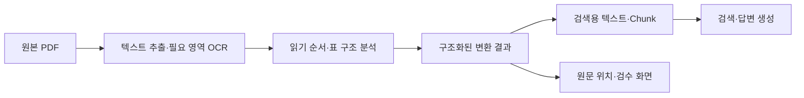

## 글자는 모두 있는데 금액을 잘못 답한다

사내 출장비 규정 PDF를 RAG에 넣고 다음과 같이 질문했다고 생각해보자.

> 서울 출장에서 숙박비는 1박에 얼마까지 지급되나요?

원본 표에는 서울 100,000원, 그 외 지역 80,000원이라고 적혀 있다. 그런데 답변은 서울도 80,000원이라고 나온다. 문서에서 추출한 텍스트를 열어보면 ‘서울’, ‘그 외 지역’, ‘100,000’, ‘80,000’이 모두 있다.

글자가 빠지지 않았는데 왜 틀렸을까?

앞선 [Embedding과 Reranker 글](/posts/understanding-embedding-and-reranker/)에서는 질문에 필요한 근거를 찾고 순서를 정하는 과정을 살펴봤다. 이번에는 그보다 앞선 단계인 **원본 문서를 검색과 답변에 사용할 데이터로 바꾸는 과정**에 집중한다.

> 아래 규정·금액·추출 결과는 설명을 위한 가상 예시다. 특정 기관의 실제 규정이나 라이브러리를 실행해 얻은 결과가 아니다. 코드 예제는 직접 비교할 때 사용할 시작점이며, 특정 도구의 우수성을 입증하는 벤치마크가 아니다.
{: .prompt-info }

## 1. 같은 PDF라도 안에 들어 있는 것은 다르다

PDF는 확장자가 같아도 페이지를 구성하는 방식이 다르다.

| 유형 | 페이지에 들어 있는 정보 | 먼저 확인할 방법 |
|---|---|---|
| 디지털 문서에서 만든 PDF | 문자 정보와 배치 정보, 이미지 등 | 저장된 텍스트를 직접 추출 |
| 스캔 PDF | 종이를 촬영하거나 스캔한 이미지 | 이미지에서 글자를 인식하는 OCR |
| OCR 텍스트가 추가된 스캔 PDF | 스캔 이미지와 이미 인식된 텍스트 층 | 추출한 글자와 보이는 원문이 일치하는지 비교 |

텍스트 선택과 복사가 되는지 확인하면 초기 구분에 도움이 된다. 다만 복사가 된다고 내용이 정확한 것은 아니다. 스캔 이미지 뒤의 OCR 텍스트에 오인식이 남아 있을 수 있다. 한 파일 안에 디지털 페이지와 스캔 페이지가 섞여 있기도 하므로 페이지별로 확인한다.

**OCR(Optical Character Recognition)**은 이미지에서 글자를 인식하는 과정이다. 이미 문자 정보가 있는 PDF의 텍스트를 읽는 것과는 다르다. `pypdf`도 텍스트 추출과 OCR을 구분하며, 이미지 안의 글자를 직접 인식하는 기능은 제공하지 않는다. [pypdf 텍스트 추출 문서](https://pypdf.readthedocs.io/en/stable/user/extract-text.html)

텍스트 추출이 잘되는 문서까지 모두 이미지로 바꿔 OCR을 적용할 필요는 없다. 원래 있던 문자 정보를 활용할 수 있는지 먼저 확인하고, 스캔 영역이나 추출이 잘못된 페이지에 필요한 처리를 선택한다.

## 2. 글자를 읽는 것과 문서 구조를 읽는 것은 다르다

문서 파싱은 문서를 읽어 프로그램이 다룰 수 있는 형태로 바꾸는 과정이다. 사용하는 도구에 따라 결과가 문자열일 수도 있고, 문단·표·그림과 위치 정보를 담은 구조일 수도 있다.

이 과정을 살펴볼 때는 다음 역할을 구분하면 이해하기 쉽다.

| 처리 | 확인하는 질문 | 실패 사례 |
|---|---|---|
| 텍스트 추출 | PDF에 저장된 문자를 읽었는가? | 글자 깨짐, 공백·줄바꿈 오류 |
| OCR | 이미지 속 글자를 올바르게 인식했는가? | 숫자 `0`을 문자 `O`로 인식 |
| 레이아웃 분석 | 제목·본문·표는 어디에 있고 어떤 순서로 읽는가? | 두 단의 문장을 번갈아 연결 |
| 표 구조 인식 | 어느 값이 어느 행·열과 병합 셀에 속하는가? | 지역과 금액의 연결을 바꿈 |

제품에 따라 이 기능들을 하나의 OCR API나 문서 변환 파이프라인으로 제공할 수 있다. 여기서 역할을 구분하는 목적은 기능 이름을 통일하려는 것이 아니라, **어느 정보가 잘못됐는지 찾기 위해서다.**

예를 들어 두 단으로 작성된 보고서에서 왼쪽 문단 중간에 오른쪽 문단이 끼어들었다면 글자 인식률만 높여서는 해결하기 어렵다. 표의 숫자는 모두 맞는데 열이 바뀌었다면 셀 배치와 헤더 연결을 확인해야 한다.

## 3. 표를 한 줄로 펴면 어떤 정보가 사라질까?

원본 PDF에 다음과 같은 표가 있다고 하자.

**별표 2. 국내 출장 숙박비 상한**

적용일: 2026년 1월 1일 / 단위: 원, 1인 1박

| 구분 | 서울 | 그 외 지역 |
|---|---:|---:|
| 숙박비 상한 | 100,000 | 80,000 |

※ 상한을 초과하는 비용은 사전 승인을 받은 경우에만 정산할 수 있다.

이를 변환하는 과정에서 아래와 같은 문자열만 남았다고 생각해보자.

```text
숙박비 상한 서울 그 외 지역 80,000 100,000
```

글자와 숫자는 있지만 어느 지역에 어느 금액이 대응하는지 불명확하다. 적용일과 단위, 초과 정산 조건도 사라졌다. 이후 모델이 그럴듯한 연결을 만들어내면 문장은 자연스러워도 답은 틀릴 수 있다.

PDF의 표가 항상 스프레드시트처럼 셀 객체로 저장되는 것은 아니다. 문자들이 좌표에 배치되어 있어 행과 열을 추정해야 하는 경우가 있다. [pypdf의 표 추출 어려움 설명](https://pypdf.readthedocs.io/en/stable/user/extract-text.html#why-text-extraction-is-hard)

이 예시를 검색에 사용할 데이터로 바꾼다면 다음 관계를 보존하는 것이 목표다.

```text
문서: 2026년 여비 규정
항목: 별표 2. 국내 출장 숙박비 상한
적용일: 2026-01-01
단위: 원, 1인 1박
서울: 100,000
그 외 지역: 80,000
예외: 상한 초과 비용은 사전 승인 시에만 정산 가능
```

이는 보존할 정보를 보여주는 표현 예시다. 파서가 이 문장을 그대로 반환한다는 뜻은 아니다. 원본 표와 연결된 구조를 먼저 확보하고, 그 구조를 바탕으로 검색용 표현을 만들 수 있다.

병합 셀이 있는 표는 더 주의해야 한다. 빈 셀이 상위 행의 값을 이어받는지, 실제로 값이 없는지 원본에서 확인한다. 모든 빈 셀을 일괄적으로 이전 값으로 채우면 존재하지 않는 관계를 만들 수 있다. 다음 페이지로 이어지는 표도 헤더와 적용 범위가 같은지 확인한 뒤 연결한다.

## 4. 같은 PDF를 두 가지 방식으로 변환해보기

직접 비교할 때는 같은 입력 파일에서 출발한다. 텍스트가 있는 PDF로 먼저 구조 차이를 보고, 스캔 PDF를 별도로 넣어 OCR 필요성을 확인하면 원인을 구분하기 쉽다.

아래는 작업 폴더에 `travel-policy.pdf`를 준비한 뒤 실행할 수 있는 예제다. 출력은 `parsing-output` 폴더에 저장한다. Python 환경은 Docling의 설치 요구사항을 확인해 준비한다. [Docling 설치 문서](https://docling-project.github.io/docling/getting_started/installation/)

```bash
python -m pip install pypdf docling
```

### 저장된 텍스트를 추출하는 기준선

```python
from pathlib import Path

from pypdf import PdfReader

output_dir = Path("parsing-output")
output_dir.mkdir(exist_ok=True)

reader = PdfReader("travel-policy.pdf")
pages = []

for page_no, page in enumerate(reader.pages, start=1):
    text = page.extract_text() or ""
    pages.append(f"## PDF page {page_no}\n\n{text}")

(output_dir / "plain-text.txt").write_text(
    "\n\n".join(pages), encoding="utf-8"
)
```

이 결과는 저장된 문자를 읽는 기준선이다. 빈 결과가 나오면 페이지 이미지 여부를 확인한다. 이미지뿐인 페이지는 이 코드만으로 인식할 수 없다. 텍스트가 있더라도 읽기 순서와 표의 관계는 원본과 비교해야 한다.

### Docling으로 문서와 표를 변환하기

Docling은 텍스트·표·그림, 문서 계층과 출처 정보를 담는 `DoclingDocument`를 제공한다. 위치 정보는 입력과 변환 결과에 따라 제공될 수 있다. [Docling 문서 모델](https://docling-project.github.io/docling/concepts/docling_document/)

```python
from pathlib import Path

from docling.document_converter import DocumentConverter

output_dir = Path("parsing-output")
output_dir.mkdir(exist_ok=True)

converter = DocumentConverter()
document = converter.convert("travel-policy.pdf").document

(output_dir / "document.md").write_text(
    document.export_to_markdown(), encoding="utf-8"
)

for table_no, table in enumerate(document.tables, start=1):
    (output_dir / f"table-{table_no}.html").write_text(
        table.export_to_html(doc=document), encoding="utf-8"
    )
```

문서 전체는 Markdown으로, 탐지된 표는 HTML로 저장한다. 기본 변환과 표 내보내기는 공식 예제를 참고했다. [Docling 기본 사용법](https://docling-project.github.io/docling/usage/), [표 내보내기 예제](https://docling-project.github.io/docling/_generated/examples/export_tables/)

Markdown이 만들어졌다는 사실만으로 변환이 정확하다고 판단하지 않는다. `plain-text.txt`, `document.md`, 표 HTML을 원본 페이지와 나란히 놓고 지역·금액·헤더의 연결을 확인한다. 표 HTML도 인식 결과를 표현한 것이므로 원본과 다를 수 있다.

이 예제는 기본 설정으로 변환하는 시작점이다. 한국어 스캔 문서는 OCR 엔진의 한국어 지원과 언어 모델 설정을 별도로 확인해야 한다. 필요한 추가 패키지나 시스템 프로그램도 엔진에 따라 다르다. [Docling OCR 문서](https://docling-project.github.io/docling/concepts/OCR/)

또한 최초 실행에는 모델 다운로드가 발생할 수 있다. 폐쇄망에서는 패키지만 설치하는 것으로 끝내지 않고 사용할 모델 파일과 실행 설정을 준비해야 한다. [Docling 오프라인 사용 안내](https://docling-project.github.io/docling/usage/advanced_options/#model-prefetching-and-offline-usage)

## 5. Markdown은 확인하기 좋지만 모든 구조를 담지는 못한다

Markdown은 변환 결과를 읽고 LLM에 전달하기 편하다. 하지만 일반적인 Markdown 표는 병합 셀을 그대로 표현하기 어렵다. 복잡한 헤더, 셀 위치와 원문 좌표까지 문자열 하나에 담으려 하면 정보가 줄어들 수 있다.

따라서 원본과 구조화된 변환 결과를 남겨두고, 검색용 Markdown이나 텍스트는 그 결과에서 만든 파생 데이터로 관리하는 편이 좋다. Docling처럼 문서 계층과 출처를 표현하는 구조를 사용하더라도 실제로 필요한 필드가 채워졌는지 확인한다.



도식은 역할을 구분하기 위한 것이며, 실제 도구에서는 일부 처리가 병렬로 실행되거나 하나의 모델에서 함께 수행될 수 있다.

원문을 다시 찾을 수 있도록 다음 정보를 함께 관리하면 검수와 재처리에 도움이 된다.

| 정보 | 사용하는 이유 |
|---|---|
| 문서 ID·원본 파일 해시 | 어떤 파일에서 만든 결과인지 식별 |
| PDF 페이지 순번·원문 위치 | 잘못된 값이 보이는 영역으로 이동 |
| 표·문단 ID와 제목 경로 | 검색 조각을 원래 문맥과 연결 |
| 적용일·문서 버전 | 오래된 규정과 현재 규정을 구분 |
| 파서·OCR 모델 버전과 설정 | 변환 결과를 재현하고 변경 영향 비교 |

PDF의 세 번째 페이지와 문서에 인쇄된 ‘1쪽’은 다를 수 있다. 페이지 번호가 무엇을 뜻하는지 정하고, 적용일처럼 업무상 중요한 메타데이터는 추출값을 검증한 뒤 사용한다.

## 6. 검색 단위로 나눌 때도 관계를 유지해야 한다

문서 변환이 정확해도 다음 단계에서 표의 제목과 헤더를 잘라내면 같은 문제가 다시 생긴다.

예를 들어 `서울: 100,000`만 남은 조각으로는 교통비인지 숙박비인지 알 수 없다. 큰 표를 행 단위로 나눠야 한다면 각 조각에 제목, 열 이름, 단위와 필요한 적용 조건을 함께 제공하는 방식을 검토한다.

```text
2026년 여비 규정 > 별표 2 > 국내 출장 숙박비 상한
적용일: 2026-01-01 / 단위: 원, 1인 1박
지역: 서울 / 숙박비 상한: 100,000
상한 초과 정산 조건: 사전 승인 필요
원문 위치: 문서 ID travel-policy-2026, PDF 3번째 페이지, 표 1
```

이때 예외 조항을 모든 행에 복사해도 되는지는 적용 범위를 확인해야 한다. 특정 직급이나 지역에만 적용되는 각주를 전체 표의 조건으로 확장하면 변환 과정에서 새로운 오류를 만든다.

표가 작다면 제목·표·각주를 함께 유지하는 것부터 시작한다. 너무 커서 나눠야 할 때 관계를 보존하는 규칙을 추가하고, 각 조각이 원본 표로 돌아갈 수 있게 한다.

## 7. 글자 정확도와 업무 정답을 나눠서 확인하기

파서를 비교할 때 “텍스트가 많이 나왔다”는 기준만으로는 부족하다. 출장비 문서에서는 숫자 하나와 열 연결 하나가 답을 바꿀 수 있다.

| 평가 대상 | 확인 방법 |
|---|---|
| 문자 인식 | 사람이 확인한 정답 텍스트와 비교. 금액·날짜·단위는 별도 집계 |
| 읽기 순서 | 다단 문서와 페이지 경계에서 문장이 올바르게 이어지는지 확인 |
| 표 구조 | 행·열 헤더와 값의 연결, 병합 셀과 각주 적용 범위 확인 |
| 출처 | 답변 근거를 실제 원문 페이지·영역에서 다시 찾을 수 있는지 확인 |
| 업무 질문 | 지역별 금액, 예외 조건, 적용일에 관한 질문에 필요한 정보가 남았는지 확인 |
| 운영 비용 | 처리 시간·메모리·실패율과 수동 검수가 필요한 문서 비율 기록 |

OCR에는 CER(Character Error Rate) 같은 지표를 사용할 수 있다. CER은 정답 문자 수를 기준으로 문자 삽입·삭제·치환 오류를 집계한다. 비교할 때는 공백과 줄바꿈을 어떻게 처리했는지도 고정해야 한다.

다만 문자 오류율이 낮아도 표의 열 연결이 뒤바뀔 수 있다. 평가 세트에는 ‘서울 → 숙박비 상한 → 100,000원 → 1인 1박’처럼 확인할 관계를 함께 표시하는 것이 좋다. 이는 이 업무에 맞춘 평가 항목이며, 범용 표 인식 벤치마크 점수와 구분한다.

처음에는 정상 문서뿐 아니라 병합 셀, 다음 페이지로 이어지는 표, 작은 각주, 회전된 스캔, 한국어·영어 혼합 문서를 포함해 비교한다. 모든 조건을 한 번에 바꾸지 않고 텍스트 추출, OCR, 구조 분석 중 어느 처리가 개선에 기여했는지 확인한다.

최종 RAG 답변도 별도로 평가한다. 전처리 효과를 비교할 때는 검색 설정과 답변 모델을 고정하고, 먼저 변환된 데이터에 정답 근거가 남아 있는지 본다. 데이터에 근거가 없는데 답변이 맞았다면 모델의 추측으로 맞았을 가능성도 확인해야 한다.

## 검색 전에 원문의 관계부터 확인하기

PDF에서 글자가 추출됐다는 것과 문서의 의미를 보존했다는 것은 다르다. OCR은 이미지 속 글자를 읽는 데 필요하고, 읽기 순서와 표의 관계를 유지하려면 문서 구조도 함께 다뤄야 한다.

서울 숙박비를 잘못 답했다면 원본 표, 변환 결과, 최종 검색 조각을 차례로 열어보자. 어느 단계에서 지역과 금액의 연결이 바뀌었는지 찾으면 수정할 대상도 명확해진다.

**검색 모델이 받는 것은 원본 PDF 자체가 아니라, 변환하고 나눈 데이터다.** 검색을 개선하기 전에 그 데이터가 원문의 금액·조건·출처를 제대로 담고 있는지 확인하는 것이 출발점이다.
