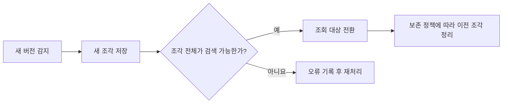

## 새 규정을 올렸는데 예전 숙박비가 검색된다

사내 출장비 규정이 개정돼 서울 숙박비 상한이 1박 100,000원에서 120,000원으로 올랐다고 하자. 문서 저장소에는 새 PDF가 있고, 파싱 결과에도 120,000원이 정확히 들어 있다. 그런데 챗봇에 물어보면 여전히 100,000원이라고 답한다.

검색 결과를 열어보니 개정 전 부록이 그대로 남아 있다. 새 PDF에서는 부록을 본문 표에 합치면서 문서 조각이 세 개에서 두 개로 줄었다. 색인 작업은 앞의 두 조각을 갱신했지만, 세 번째 조각까지 정리하지는 않았다.

앞선 [문서 파싱과 OCR 글](/posts/understanding-document-parsing-and-ocr/)에서는 표의 금액과 조건을 변환 과정에서 어떻게 보존하는지 살펴봤다. 이번에는 변환이 끝난 문서가 개정되거나 삭제될 때 검색 인덱스를 어떻게 맞춰가는지 살펴본다.

> 출장비 규정과 금액, 문서 버전은 설명을 위한 가상 예시다.
{: .prompt-info }

## 1. 원본 문서와 버전을 추적한다

검색 결과에 있는 조각에서 원본 문서와 버전을 찾을 수 있어야 한다. 원본 저장소에서 문서 ID를 제공한다면 파일명이 달라져도 그 ID를 유지한다. 파일 경로를 ID로 사용하는 환경이라면 이름 변경을 옛 경로 삭제와 새 경로 추가로 처리한다.

| 기록할 정보 | 출장비 규정 예시 | 쓰는 곳 |
|---|---|---|
| 문서 ID | `policy-travel` | 한 문서에서 만들어진 조각 찾기 |
| 원본 버전 | `17`, `18` | 처리한 원본 확인, 늦게 도착한 변경 판별 |
| 파일 해시 | PDF 바이트의 SHA-256 | 같은 파일을 다시 변환해야 하는지 판단 |
| 적용 기간 | 2026-11-17부터 | 기준일에 적용되는 규정 선택 |
| 처리 설정 버전 | 파서·분할 규칙·임베딩 모델 조합 | 같은 원본도 다시 색인해야 하는지 판단 |

이 예에서는 원본이 문서별로 증가하는 버전 번호를 제공한다. 원본의 버전 식별자로 순서를 판단할 수 없다면, 작업을 공개하기 전에 최신 원본 식별자와 일치하는지 확인하는 식으로 처리한다. 동시에 여러 작업이 끝날 수 있다면 버전 확인과 공개를 함께 제어해야 한다.

PDF 해시가 같아도 공개 범위나 적용일은 바뀔 수 있다. 내용과 처리 설정이 같으면 파싱과 임베딩 결과를 재사용할 수 있다. 검색에 쓰는 권한과 적용 기간은 따로 갱신한다.

## 2. 개정된 문서의 조각을 한 묶음으로 교체한다

| 조회 시점 | 검색에 노출할 조각 |
|---|---|
| 개정 전 | 버전 17의 조각 1, 2, 3 |
| 개정 후 | 버전 18의 조각 1, 2 |

문서 ID와 조각 순번을 키로 잡으면 새 조각 1번과 2번은 기존 값을 덮어쓴다. 3번은 별도로 지워야 한다. 버전까지 키에 넣으면 두 버전을 함께 보관할 수 있고, 검색 경로에서 조회할 버전을 지정해야 한다.

변경이 드물고 짧은 검색 공백을 허용할 수 있다면, 문서 ID로 기존 조각을 지운 뒤 새 조각을 넣는 방식으로 시작할 수 있다. 삭제 후 새 조각을 쓰다가 실패하면 해당 문서의 검색 결과가 비거나 일부만 나온다. 개정 중에도 기존 문서를 조회할 수 있어야 한다면 새 조각을 따로 준비해 **전체 조각이 검색 가능한 상태에서 조회 대상을 전환**한다.



이 방식은 검색 경로가 공개할 버전을 적용할 때 동작한다. 옛 조각과 새 조각을 함께 검색해서 상위 몇 개만 가져온 뒤 옛 버전을 걸러내면, 옛 조각이 후보 자리를 먼저 차지할 수 있다. 후보 검색 단계에서 조회할 버전을 제한할 수 있는지 확인한다.

쓰기 요청의 성공 시점과 검색 가능 시점도 다를 수 있다. Elasticsearch에서는 `refresh=wait_for`로 해당 변경이 검색에 보일 때까지 기다릴 수 있다. 여러 조각을 한 번에 쓰는 경우에는 응답의 각 항목에서 오류가 있었는지도 확인한다. [Elasticsearch refresh 설정](https://www.elastic.co/docs/reference/elasticsearch/rest-apis/refresh-parameter), [Bulk API](https://www.elastic.co/docs/api/doc/elasticsearch/operation/operation-bulk)

## 3. 삭제와 공개 범위 변경도 반영한다

수정된 파일만 처리하면 원본에서 삭제된 문서가 인덱스에 남을 수 있다. 원본이 삭제 이벤트를 제공하면 해당 변경을 반영한다. 파일 목록을 주기적으로 읽는 방식이라면 목록을 완전히 읽은 뒤 지난 목록과 비교한다. 페이지 일부만 읽었거나 목록이 불완전한데 차집합을 계산하면 정상 문서까지 지울 수 있다.

| 원본의 변화 | 검색에서 반영할 내용 |
|---|---|
| 새 규정 게시 | 질문의 기준일에 적용되는 버전을 조회 |
| 이전 규정 폐기 | 현재 조회에서 제외하고, 보존 정책에 따라 과거 기준일 조회에 사용 |
| 문서 삭제 | 모든 관련 조각을 검색에서 제외하고 보존 정책에 따라 정리 |
| 공개 범위 축소 | 바뀐 권한을 후보 검색에 적용하고 캐시된 답변과 근거에도 반영 |

문서의 게시일과 시행일이 다르면 새 규정을 미리 색인해둘 수 있다. 시행일 전에는 기존 버전이, 시행일부터는 개정 버전이 현재 조회에 나와야 한다. 과거 기준일 조회를 지원한다면 각 버전에 적용 기간을 붙이고, 질문의 기준일과 사용자의 접근 권한을 모두 확인한다.

삭제나 권한 철회가 즉시 적용돼야 하는 서비스에서는 인덱스 반영이 끝날 때까지 기다릴 수 없다. 검색 후보를 모델에 전달하거나 캐시된 답변을 반환하기 전에 현재 삭제 상태와 접근 권한을 확인하는 경로를 둔다.

## 4. 늦게 끝난 작업이 최신 상태를 덮어쓰지 않게 한다

버전 17 작업이 지연되는 동안 버전 18 작업이 먼저 완료될 수 있다. 각 작업이 끝난 순서대로 조회 대상을 바꾸면 다음과 같은 일이 생긴다.

```text
버전 17 처리 시작 → 지연
버전 18 처리 완료 → 버전 18 공개
버전 17 처리 완료 → 버전 17 공개 → 옛 규정이 다시 검색됨
```

재시도에서 중복 조각이 생기지 않도록, 같은 원본 버전과 처리 설정으로 같은 조각을 만들 때 같은 ID를 사용한다. 조회 대상을 바꿀 때는 현재 버전이 자신보다 낮은 경우에만 갱신하는 조건부 쓰기나 문서별 직렬 처리를 사용할 수 있다. 버전을 먼저 읽고 나중에 조건 없이 쓰면, 두 작업 사이에 다른 작업이 최신 버전을 공개할 수 있다.

삭제에도 변경 순서를 남긴다. 버전 19에서 문서가 삭제됐다는 기록이 있으면 늦게 끝난 버전 18 작업의 공개를 막을 수 있다. 삭제 기록은 이전 작업이나 이벤트가 다시 처리될 수 있는 기간에 맞춰 보관한다.

## 5. 전체 인덱스를 새로 만드는 경우

규정 몇 건이 바뀌었다면 변경 문서만 처리하는 증분 색인으로 시작할 수 있다. 임베딩 모델이나 문서 분할 규칙을 교체하면 기존 문서도 영향을 받는다. 임베딩 모델을 바꿀 때는 문서 벡터를 다시 만들고 검색 요청의 질문 벡터도 같은 모델에서 생성하도록 설정한다.

새 인덱스를 별도로 만들어 전환한다면 다음 순서로 진행할 수 있다.

1. 특정 시점의 원본 목록을 기준으로 새 인덱스를 만든다.
2. 그 이후 발생한 추가·수정·삭제·권한 변경을 새 인덱스에 적용한다. 변경 이력이 없다면 전환 직전에 원본과 다시 대조한다. 전환 순간까지 일치해야 한다면 최종 대조부터 전환까지 원본 변경을 통제하거나 그 사이 변경도 빠짐없이 반영할 수 있어야 한다.
3. 문서 ID와 버전, 실패 건수를 확인한다. 대표 질문을 검색하고 폐기 문서와 제한 문서의 노출 여부도 본다.
4. 검색의 조회 대상을 전환한다. 이전 인덱스로 돌아가야 한다면 전환 이후 발생한 변경과 권한 상태도 먼저 반영한다.

Elasticsearch에서는 서비스가 같은 이름을 계속 사용하도록 인덱스에 별칭을 붙일 수 있다. 기존 인덱스에서 별칭을 제거하고 새 인덱스에 붙이는 작업을 한 요청으로 보내고, 응답에서 별칭이 의도대로 바뀌었는지 확인한다. 질문 임베딩 모델도 교체한다면 검색 애플리케이션에서 모델과 조회 인덱스가 같은 세대를 사용하도록 전환을 맞춘다. [Elasticsearch 별칭 문서](https://www.elastic.co/docs/manage-data/data-store/aliases)

## 6. 답변을 평가하기 전에 검색 결과를 확인한다

검색이 반환한 문서 ID, 버전, 조각을 확인하면 어느 단계에서 옛 규정이 들어왔는지 확인할 수 있다. 처음에는 아래 사례를 같은 문서로 재현해볼 수 있다.

| 재현할 상황 | 검색에서 확인할 결과 |
|---|---|
| 금액 개정 및 조각 수 감소 | 120,000원이 검색되고 옛 버전의 세 번째 조각은 현재 조회에서 빠진다 |
| 옛 버전 작업이 늦게 완료 | 현재 조회가 버전 17로 되돌아가지 않는다 |
| 삭제 후 이전 작업 재시도 | 삭제 문서가 다시 검색되지 않는다 |
| 새 조각 일부 쓰기 실패 | 준비 중인 버전이 공개되지 않는다 |
| 공개 범위 축소 | 권한을 잃은 사용자에게 조각이나 캐시된 근거가 보이지 않는다 |
| 시행일이 미래인 개정본 게시 | 시행일 전과 후에 각각 올바른 규정이 검색된다 |

운영에서는 원본 변경이 검색에 반영되기까지 걸린 시간과 반영에 실패한 문서 수를 함께 기록한다. 주기적으로 원본과 인덱스의 문서 ID·버전을 대조하면 처리 알림에 잡히지 않은 누락도 찾을 수 있다.

서울 숙박비가 여전히 100,000원이라면 질문의 기준일에 적용되는 원본 버전과 검색 결과의 버전부터 비교한다. 올바른 버전의 조각이 검색됐는데도 답변이 틀렸다면, 최종 입력에 어떤 근거가 전달됐는지 확인한다. [RAG 실패 지점별 진단](/posts/rag-failure-diagnosis/)
